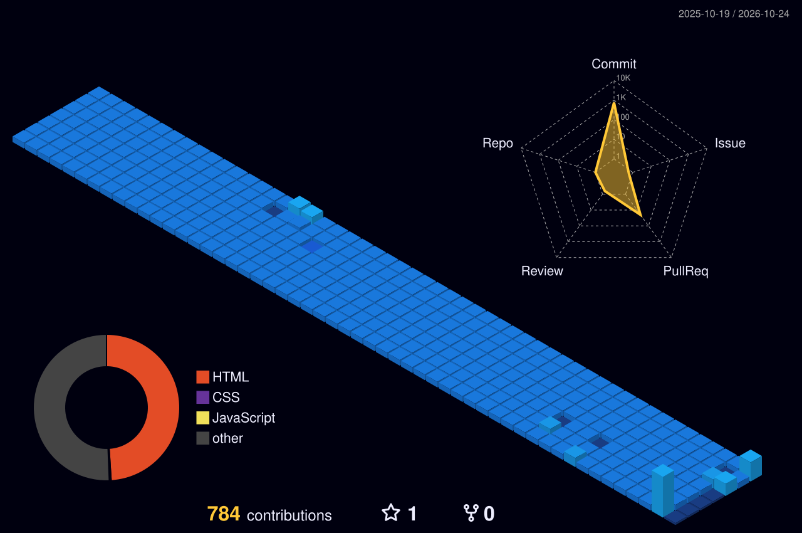

 

---

### 👋 Sobre mim

Sou o **Carlos Almir**, desenvolvedor web em formação contínua. Comecei pelo HTML e CSS, passei pelo JavaScript e hoje construo aplicações completas — de páginas responsivas a apps de desktop para controle financeiro e organização pessoal.

- 🔭 Trabalhando em projetos pessoais de **finanças** e **saúde**, com versões web e desktop
- 🌱 Estudando arquitetura de aplicações, testes e boas práticas de front-end
- 🎓 13 certificados: [Alura](https://www.dropbox.com/s/seifbmqwdyisi24/Certificados%20Alura.png?dl=0) (11), [Origamid](https://www.dropbox.com/s/s9elgsagf43fq66/Certificado%20Origamid.png?dl=0) (1) e [Curso em Vídeo](https://www.dropbox.com/s/gll7nyr0yz6x640/Certivicado%20CeV.png?dl=0) (1)

### 🛠️ Tecnologias

  

### 🚀 Projetos em destaque

**Teste online:**
[Jogo da Velha](https://almircs.github.io/Jogo-da-Velha/) ·
[Freeway](https://almircs.github.io/Freeway/) ·
[Alura MIDI](https://almircs.github.io/Aluramidi/) ·
[HZC](https://almircs.github.io/Flex-e-Grid/) ·
[Barbearia](https://almircs.github.io/Barbearia/) ·
[Exercícios HTML & CSS](https://almircs.github.io/HTML-CSS/)

### 📊 Estatísticas

  

<picture>
  <source media="(prefers-color-scheme: dark)" srcset="https://raw.githubusercontent.com/almircs/almircs/output/github-contribution-grid-snake-dark.svg">
  
</picture>

<b>Ver contribuições em 3D</b>

 

