---

### 👋 Olá, eu sou o Carlos!

Desenvolvedor web em formação contínua. Comecei pelo HTML e CSS, passei pelo JavaScript e hoje construo aplicações completas — de páginas responsivas a apps de desktop para controle financeiro e organização pessoal.

- 🔭 Trabalhando em projetos pessoais de **finanças** e **saúde**, com versões web e desktop
- 🌱 Estudando arquitetura de aplicações, testes e boas práticas de front-end
- 💬 Me encontre no [LinkedIn](https://www.linkedin.com/in/carlos-almir/), no [Instagram](https://www.instagram.com/almircs.dev/) e no [YouTube](https://www.youtube.com/channel/UCsoIAs_geL01KE6Ov2DIhOg)

 

### 📋 Dados

<table>
  <tr>
    <th align="left">Área</th>
    <th align="left">Detalhes</th>
  </tr>
  <tr>
    <td><b>Linguagens</b></td>
    <td>
      
      
      
      
      
    </td>
  </tr>
  <tr>
    <td><b>Bibliotecas e técnicas</b></td>
    <td>
      
      
      
    </td>
  </tr>
  <tr>
    <td><b>Bancos de dados</b></td>
    <td>
      
      
    </td>
  </tr>
  <tr>
    <td><b>Ferramentas</b></td>
    <td>
      
      
      
      
      
    </td>
  </tr>
  <tr>
    <td><b>Sistemas</b></td>
    <td>
      
      
    </td>
  </tr>
  <tr>
    <td><b>Inteligência Artificial</b></td>
    <td>
      
      
      
      
      
    </td>
  </tr>
  <tr>
    <td><b>Áreas de interesse</b></td>
    <td>
      
      
      
      
      
    </td>
  </tr>
  <tr>
    <td><b>Certificados</b></td>
    <td>
      
      
      
    </td>
  </tr>
  <tr>
    <td><b>Contato</b></td>
    <td>
      
      
      
    </td>
  </tr>
</table>

### 🚀 Projetos em destaque

**Teste online:**
[Jogo da Velha](https://almircs.github.io/Jogo-da-Velha/) ·
[Freeway](https://almircs.github.io/Freeway/) ·
[Alura MIDI](https://almircs.github.io/Aluramidi/) ·
[HZC](https://almircs.github.io/Flex-e-Grid/) ·
[Barbearia](https://almircs.github.io/Barbearia/) ·
[Exercícios HTML & CSS](https://almircs.github.io/HTML-CSS/)

### 📊 Estatísticas

  

<picture>
  <source media="(prefers-color-scheme: dark)" srcset="https://raw.githubusercontent.com/almircs/almircs/output/github-contribution-grid-snake-dark.svg">
  
</picture>

<b>Ver contribuições em 3D</b>

 

 

