---

<picture>
  <source media="(prefers-color-scheme: dark)" srcset="./assets/apresentacao-escuro.svg">
  <source media="(prefers-color-scheme: light)" srcset="./assets/apresentacao-claro.svg">
  
</picture>

### 👋 Olá, eu sou o Carlos!

Técnico em eletrônica com **mais de 30 anos** em manutenção e automação industrial — de CLPs Siemens e robôs ABB e KUKA a equipamentos biomédicos. Desde 2022 estudo programação e hoje construo meus próprios apps web e desktop.

- 🔭 Projetos pessoais de **finanças** e **saúde**
- 💬 [Instagram](https://www.instagram.com/almircs.dev/) · [YouTube](https://www.youtube.com/channel/UCsoIAs_geL01KE6Ov2DIhOg)

 

<picture>
  <source media="(prefers-color-scheme: dark)" srcset="./assets/terminal-escuro.svg">
  <source media="(prefers-color-scheme: light)" srcset="./assets/terminal-claro.svg">
  
</picture>

### 🤖 IA no meu dia a dia

<picture>
  <source media="(prefers-color-scheme: dark)" srcset="./assets/fluxo-ia-escuro.svg">
  <source media="(prefers-color-scheme: light)" srcset="./assets/fluxo-ia-claro.svg">
  
</picture>

### 🛠️ Em construção

<picture>
  <source media="(prefers-color-scheme: dark)" srcset="./assets/finora-escuro.svg">
  <source media="(prefers-color-scheme: light)" srcset="./assets/finora-claro.svg">
  
</picture>
<picture>
  <source media="(prefers-color-scheme: dark)" srcset="./assets/helyx-escuro.svg">
  <source media="(prefers-color-scheme: light)" srcset="./assets/helyx-claro.svg">
  
</picture>

### 📋 Dados

<table>
  <tr>
    <th align="left">Área</th>
    <th align="left">Detalhes</th>
  </tr>
  <tr>
    <td><b>Automação industrial</b></td>
    <td>
      
      
      
      
      
    </td>
  </tr>
  <tr>
    <td><b>Eletrônica</b></td>
    <td>
      
      
      
      
    </td>
  </tr>
  <tr>
    <td><b>Linguagens</b></td>
    <td>
      
      
      
      
      
    </td>
  </tr>
  <tr>
    <td><b>Bibliotecas e técnicas</b></td>
    <td>
      
      
      
    </td>
  </tr>
  <tr>
    <td><b>Bancos de dados</b></td>
    <td>
      
      
    </td>
  </tr>
  <tr>
    <td><b>Ferramentas</b></td>
    <td>
      
      
      
      
      
    </td>
  </tr>
  <tr>
    <td><b>Sistemas</b></td>
    <td>
      
      
      
    </td>
  </tr>
  <tr>
    <td><b>Inteligência Artificial</b></td>
    <td>
      
      
      
      
      
    </td>
  </tr>
  <tr>
    <td><b>Áreas de interesse</b></td>
    <td>
      
      
      
      
      
      
      
    </td>
  </tr>
  <tr>
    <td><b>Certificados</b></td>
    <td>
      
      
      
      
      
    </td>
  </tr>
  <tr>
    <td><b>Contato</b></td>
    <td>
      
      
    </td>
  </tr>
</table>

### 🚀 Projetos em destaque

<a href="https://github.com/almircs/Jogo-da-Velha"><picture>
  <source media="(prefers-color-scheme: dark)" srcset="https://github-readme-stats.vercel.app/api/pin/?username=almircs&repo=Jogo-da-Velha&theme=dark&hide_border=true&locale=pt-br">
  <source media="(prefers-color-scheme: light)" srcset="https://github-readme-stats.vercel.app/api/pin/?username=almircs&repo=Jogo-da-Velha&theme=default&hide_border=false&locale=pt-br">
  
</picture></a>
<a href="https://github.com/almircs/Freeway"><picture>
  <source media="(prefers-color-scheme: dark)" srcset="https://github-readme-stats.vercel.app/api/pin/?username=almircs&repo=Freeway&theme=dark&hide_border=true&locale=pt-br">
  <source media="(prefers-color-scheme: light)" srcset="https://github-readme-stats.vercel.app/api/pin/?username=almircs&repo=Freeway&theme=default&hide_border=false&locale=pt-br">
  
</picture></a>
<a href="https://github.com/almircs/Aluramidi"><picture>
  <source media="(prefers-color-scheme: dark)" srcset="https://github-readme-stats.vercel.app/api/pin/?username=almircs&repo=Aluramidi&theme=dark&hide_border=true&locale=pt-br">
  <source media="(prefers-color-scheme: light)" srcset="https://github-readme-stats.vercel.app/api/pin/?username=almircs&repo=Aluramidi&theme=default&hide_border=false&locale=pt-br">
  
</picture></a>
<a href="https://github.com/almircs/Flex-e-Grid"><picture>
  <source media="(prefers-color-scheme: dark)" srcset="https://github-readme-stats.vercel.app/api/pin/?username=almircs&repo=Flex-e-Grid&theme=dark&hide_border=true&locale=pt-br">
  <source media="(prefers-color-scheme: light)" srcset="https://github-readme-stats.vercel.app/api/pin/?username=almircs&repo=Flex-e-Grid&theme=default&hide_border=false&locale=pt-br">
  
</picture></a>
<a href="https://github.com/almircs/Barbearia"><picture>
  <source media="(prefers-color-scheme: dark)" srcset="https://github-readme-stats.vercel.app/api/pin/?username=almircs&repo=Barbearia&theme=dark&hide_border=true&locale=pt-br">
  <source media="(prefers-color-scheme: light)" srcset="https://github-readme-stats.vercel.app/api/pin/?username=almircs&repo=Barbearia&theme=default&hide_border=false&locale=pt-br">
  
</picture></a>
<a href="https://github.com/almircs/HTML-CSS"><picture>
  <source media="(prefers-color-scheme: dark)" srcset="https://github-readme-stats.vercel.app/api/pin/?username=almircs&repo=HTML-CSS&theme=dark&hide_border=true&locale=pt-br">
  <source media="(prefers-color-scheme: light)" srcset="https://github-readme-stats.vercel.app/api/pin/?username=almircs&repo=HTML-CSS&theme=default&hide_border=false&locale=pt-br">
  
</picture></a>

**Teste online:**
[Jogo da Velha](https://almircs.github.io/Jogo-da-Velha/) ·
[Freeway](https://almircs.github.io/Freeway/) ·
[Alura MIDI](https://almircs.github.io/Aluramidi/) ·
[HZC](https://almircs.github.io/Flex-e-Grid/) ·
[Barbearia](https://almircs.github.io/Barbearia/) ·
[Exercícios HTML & CSS](https://almircs.github.io/HTML-CSS/)

### 📊 Estatísticas

<picture>
  <source media="(prefers-color-scheme: dark)" srcset="https://github-readme-stats.vercel.app/api?username=almircs&show_icons=true&theme=dark&hide_border=true&include_all_commits=true&count_private=true&locale=pt-br&card_width=495">
  <source media="(prefers-color-scheme: light)" srcset="https://github-readme-stats.vercel.app/api?username=almircs&show_icons=true&theme=default&hide_border=false&include_all_commits=true&count_private=true&locale=pt-br&card_width=495">
  
</picture>
<picture>
  <source media="(prefers-color-scheme: dark)" srcset="https://streak-stats.demolab.com?user=almircs&theme=dark&hide_border=true&locale=pt_BR&card_width=495&card_height=195">
  <source media="(prefers-color-scheme: light)" srcset="https://streak-stats.demolab.com?user=almircs&theme=default&hide_border=false&locale=pt_BR&card_width=495&card_height=195">
  
</picture>
<picture>
  <source media="(prefers-color-scheme: dark)" srcset="https://github-readme-stats.vercel.app/api/top-langs/?username=almircs&layout=compact&langs_count=8&theme=dark&hide_border=true&locale=pt-br&card_width=1000">
  <source media="(prefers-color-scheme: light)" srcset="https://github-readme-stats.vercel.app/api/top-langs/?username=almircs&layout=compact&langs_count=8&theme=default&hide_border=false&locale=pt-br&card_width=1000">
  
</picture>

